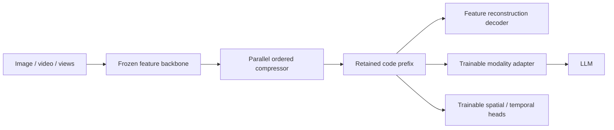

# Ordered latent compression for reusable model features

**Status:** Research proposal, not an implemented or empirically validated system. Literature claims below are linked to primary sources; proposed mechanisms and expected benefits are hypotheses. Related work was investigated by a Sol subagent and integrated with the design discussion.

**Companion:** [Compressed memory and learned retrieval for streaming SLAM](slam-compressed-memory.md).

## 1. Core question and scope

Can we turn a large feature set from a frozen image, video, or geometry foundation model into one short, ordered sequence of codes, such that every retained prefix is useful and trainable adapters or heads consume those codes directly?

The proposed interface is:

- **D1 — Parallel encoding:** Compute one maximum-length code sequence from the complete input; no token-by-token generation loop is required.
- **D2 — Progressive representation:** The first few codes describe the whole input coarsely; additional codes improve reconstruction or task performance. They are not simply the first few source patches or frames.
- **D3 — Direct consumption:** Train modality adapters and task heads on the compressed codes. Feature reconstruction is an auxiliary training path, not necessarily an inference step.
- **D4 — Frozen feature producer:** Initially freeze the foundation backbone and train the compressor, reconstruction decoder, and task interfaces. A general architecture is the goal; universal weights across unrelated model feature spaces are not assumed.

This is distinct from inserting shorter, unfamiliar tokens into an unchanged foundation model at layer l+1. It is also distinct from an autoregressive probability model used only to entropy-code existing symbols.

## 2. Main applications

| Code | Application | Intended benefit | Required trained interface |
|---|---|---|---|
| A1 | Image/video features supplied to an LLM | Fewer modality tokens in expensive LLM processing and its KV cache | Projector or query adapter, trained through language-task losses |
| A2 | VGGT or other geometry features supplied to an LLM | Compact multi-view context for 3D questions, spatial reasoning, and scene descriptions | Geometry-aware adapter and appropriate supervision |
| A3 | Direct spatial/temporal prediction | Decode depth, occupancy, motion, or other quantities without rebuilding every original feature | Query-based task heads |
| A4 | Reusable feature caches | Store backbone outputs once for repeated questions, heads, or downstream training | Code-compatible consumers or feature decoder |
| A5 | Split-device perception | Reduce feature transmission between a camera/robot/client and a server | Shared codec and explicit metadata format |

A1–A3 are the strongest initial motivations. Storage is compelling when features persist or move between devices, not automatically for a single-use forward pass. Compare storage against quantized features and against storing compressed source images and recomputing features.

This framework does not automatically compress ordinary text contexts for an unchanged LLM. Reconstructing a context from codes does not make those codes valid soft prompts. A trained adapter or cache interface is still necessary.

## 3. Representation and architecture

Let X in R^(N x d) be frozen source features and P their structural metadata: positions, frame/view identity, time, and token type as appropriate. The encoder produces

$$
Z=E_\theta(X,P)=(z_1,\ldots,z_K),\qquad z_j\in\mathbb R^{d_z}.
$$

For any supported budget k, the reconstruction decoder sees only the actual retained codes and allowed metadata:

$$
\hat X^{(k)}=D_\phi(P,Z_{1:k}).
$$

A downstream consumer instead computes its output directly from Z_{1:k}, possibly conditioned on task queries. Codes can be continuous finite-precision vectors initially; quantization can be added when storage/communication is a real objective.

C1


The reconstruction branch can be removed from normal inference. The LLM can initially remain frozen, as in the general bridge strategy demonstrated by BLIP-2; whether a frozen LLM suffices for the desired geometry tasks must be measured.

### 3.1 Encode once versus re-encode for each budget

Two contracts must not be conflated:

- **C2 — Same-code prefixes:** Compute E_K(X) once and use its exact first k outputs at every budget.
- **C3 — Budget-dependent encodings:** Compute E_k(X) separately for each requested length. Its first codes may differ from E_K(X)_{1:k}.

C2 is the primary proposal. A bidirectional encoder can satisfy C2 when it always computes all K codes before slicing: all its intermediate computation is on the encoding side of the bottleneck. If we also want E_k(X)=E_K(X)_{1:k}, use prefix-safe query interactions, such as causal latent self-attention and source features that do not receive feedback from suffix queries. This stronger property permits partial encoding when a budget is known in advance.

A causal mask is parallelizable; it does not require sequential generation of output vectors.

### 3.2 Metadata and leakage

Do not allow the feature decoder to bypass the code bottleneck through source-feature skips, full-code pooled summaries, teacher-forced feature targets, or excluded-code-dependent states. Input positions and shape are acceptable side information, but their storage and any input-dependent geometric metadata must be counted.

Decoder-side contextualization of codes must be prefix-safe. Slicing after bidirectional code self-attention can leak excluded suffix codes. Likewise, reconstruction states for short budgets must not attend to states computed for longer budgets. Channelwise LayerNorm is not a token-mixing leak, but token-axis normalization or sequence pooling can be.

## 4. Training the ordering

Use distortion at each budget:

$$
D_k=D_{\mathrm{feat}}(X,\hat X^{(k)})+\lambda D_{\mathrm{functional}}(X,\hat X^{(k)}).
$$

Feature distortion can combine scale-aware squared error and directional/cosine error. Functional distortion compares frozen downstream outputs or attention behavior on original versus reconstructed features. Separately, train direct code consumers with their own task losses; that path need not reconstruct X at all.

The all-prefix objective is

$$
\mathcal L_{\mathrm{prefix}}=\sum_{k=1}^{K}w_kD_k,\qquad w_k>0.
$$

Sampling k gives a cheaper stochastic prefix objective. Use consistent weighting if the intent is to estimate a particular all-prefix sum. Compare uniform lengths, a logarithmic budget ladder, and explicit inclusion of the full length. A ladder does not directly supervise every integer stopping point.

### 4.1 Why useful information is encouraged to appear early

Define the marginal improvement from adding code k:

$$
\Delta_k=D_{k-1}-D_k.
$$

This means reduction in error, not the number of Shannon bits in the code. An error decrease from 10 to 6 is an improvement of 4; a subsequent decrease from 6 to 5 is an improvement of 1.

For a fixed zero-code reference D_0, the prefix loss satisfies

$$
\sum_{k=1}^{K}w_kD_k
=D_0\sum_{k=1}^{K}w_k
-\sum_{t=1}^{K}\Delta_t\sum_{k=t}^{K}w_k.
$$

An early improvement receives credit at more budgets. Equal weights already encourage ordering; emphasizing short prefixes strengthens it. Start without a separate diminishing-return penalty.

This is not a guarantee of per-example monotonic improvement, decreasing marginal gains, or nonredundancy. Information can be complementary. Later codes can contain high-entropy detail with low task value. Tail undertraining is also possible, motivating deliberate full-budget exposure rather than ever-higher weights on the first few codes.

### 4.2 Direct task preservation

A useful joint objective is

$$
\mathcal L=\lambda_{\mathrm{rec}}\mathcal L_{\mathrm{prefix}}
+\lambda_{\mathrm{task}}\mathbb E_k[\mathcal L_{\mathrm{consumer}}(Z_{1:k})]
+\beta\mathcal R.
$$

Reconstruction may preserve information missing from the supervised task distribution; task loss prevents spending all capacity on feature details irrelevant to the consumer. Compare reconstruction-only, task-only, and joint training rather than assuming the joint objective wins.

Cheap reconstruction can cover many prefixes while expensive LLM or geometry-head training samples one or a few budgets. Sharing an auxiliary decoder does not make all-prefix execution of a large LLM inexpensive.

## 5. Decoding all prefixes in parallel

“All subsets” here means K nested prefixes, not the 2^K arbitrary subsets.

| Code | Decoder | What is shared | Limitation |
|---|---|---|---|
| P1 | Independent prefix decoders, batched | Parameters and some input projections | Parallel execution still repeats most decoder computation |
| P2 | Prefix-sum cross-attention | Query–key scores and cumulative weighted values | Exact sharing requires prefix-invariant queries, keys, and values |
| P3 | Additive refinement | Per-code contributions and cumulative sums | Restricts decoder expressivity |

### 5.1 Exact prefix-attention construction

For reconstruction query q_i, key a_t and value v_t, define

$$
s_{it}=q_i^\top a_t/\sqrt d,\qquad
h_i^{(k)}=
\frac{\sum_{t\leq k}\exp(s_{it})v_t}
{\sum_{t\leq k}\exp(s_{it})}.
$$

The scores are computed once, and the numerator/denominator are parallel prefix scans. This equals independently evaluating softmax cross-attention on every physically sliced prefix. Use numerically stable running-max/log-sum-exp statistics rather than unguarded exponentiation.

A shared pointwise head can map (q_i,h_i^{(k)}) to a reconstructed feature. Multi-head attention uses the same construction independently per head. The scan identity is elementary, not claimed as a new attention algorithm; its useful feature/task tradeoff in this architecture is the research question.

The first aggregation costs O(N K d) for matched attention/value widths, but producing all dense feature outputs still costs O(N K d_out) work and, if materialized, storage. Chunk losses or sample output positions when necessary.

In a deeper decoder, the updated query generally depends on k. Consequently, second-layer scores differ by prefix even without query self-attention. The same simple scan does not make an arbitrary multi-layer decoder all-prefix at one-prefix cost. Independent prefix states are then needed, or the architecture must deliberately preserve a shared computation structure.

### 5.2 Additive alternative

Use

$$
\hat x_i^{(k)}=b(p_i)+\sum_{t\leq k}g(p_i,z_{1:t}).
$$

Compute prefix-safe per-code contributions in parallel and scan them. This is a useful baseline, not an unrestricted deep decoder in disguise. Compare any accelerated implementation against independent decoding with the identical restricted architecture before comparing different architectures.

### 5.3 Correctness checks

- **V1 — Equivalence:** Compare scan outputs and gradients against physically sliced attention for every small-K prefix.
- **V2 — Suffix independence:** Perturb excluded codes after encoding; shorter-prefix outputs must remain unchanged through every decoder pathway.
- **V3 — Partial-encoding claim:** If C2 and C3 equivalence is claimed, independently compare E_k(X) with E_K(X)_{1:k}.
- **V4 — Capacity accounting:** Include output work, hidden states, code width, dtype, quantizer, and metadata—not only attention scores or code count.

A small numerical check during document preparation verified the single-layer prefix-attention output identity and the weighted-loss identity. That check did not evaluate training speedup, gradient-sharing implementation, or task benefit. Compressor execution checks are recorded in §8.4.

## 6. Budgets, quality selection, and bits

With full parallel encoding, “stopping” means selecting a retained prefix, not stopping an autoregressive generation loop.

- **B1 — Externally chosen budget:** The consumer specifies k. This is the simplest deployment policy.
- **B2 — Measured quality:** Evaluate candidate prefixes and choose the shortest with D_k <= epsilon. If none qualifies, report the unmet threshold. Reconstruction checking costs belong in the latency measurement.
- **B3 — Predicted quality:** A calibrated small predictor estimates the quality/budget curve. Test threshold violation rates under distribution shift; predictions are not guarantees.

A feature-error threshold does not certify arbitrary downstream answers. Conversely, known input-side budgets can permit partial encoding if the stronger C3 contract holds.

For discrete codes, a possible rate estimate is

$$
\mathcal R_k=\sum_{t=1}^{k}-\log_2 p_\psi(z_t\mid z_{1:t-1}).
$$

The decompressor must have the same probability model and conditioning information. Continuous vectors require actual finite-precision or quantization accounting; a continuous density alone is not a measured bitstream. Include headers, positions, lengths, codebooks, and amortized model costs where applicable. For token-count comparisons, hold width and precision fixed or report the differences.

Adding beta*k when k is externally sampled does not train adaptive length selection: that term is constant with respect to encoder parameters. A learned stopping/allocation policy or a differentiable rate term is needed for that effect.

## 7. Related work and novelty boundaries

| Ref | Primary source | Established overlap | Difference relevant here |
|---|---|---|---|
| R1 | [Learning Ordered Representations with Nested Dropout](https://proceedings.mlr.press/v32/rippel14.html), ICML 2014 | Encode-once prefix reconstruction and importance ordering | Linear-case theory does not guarantee nonlinear per-example ordering |
| R2 | [FlexTok](https://arxiv.org/html/2502.13967v1), ICML 2025 | Parallel masked register encoder, quantized same-code prefixes, nested dropout | Generative flow reconstruction; separate AR prior; not a shared all-prefix feature decoder |
| R3 | [ALIT](https://arxiv.org/html/2411.02393v1), ICLR 2025 | Recurrent token-space reconstruction with increasing capacity | Updates earlier codes; later representations are not immutable earlier prefixes |
| R4 | [Matryoshka Query Transformer](https://arxiv.org/html/2405.19315v1), NeurIPS 2024 | Variable query budgets for compact LLM visual input | Inputs only the first m queries to the encoder; identical computed prefixes across budgets are not established |
| R5 | [BLIP-2](https://arxiv.org/abs/2301.12597), ICML 2023 | Trainable compact bridge between frozen vision encoder and frozen LLM | Fixed query count; not a reconstructive prefix codec |
| R6 | [FlatDINO / Laminating Representation Autoencoders](https://arxiv.org/html/2602.04873v1), February 2026 preprint | Parallel autoencoding of frozen DINOv2 features into fewer codes | Fixed budgets; generation-oriented evaluations; authors describe preliminary results |
| R7 | [UniCompress](https://arxiv.org/html/2603.11320v1), March 2026 preprint | Reconstruction-oriented compression, then direct compact-token consumption for understanding/generation | Spatial pooling and AR decompression; fixed evaluated ratios; LLM weights are fine-tuned |
| R8 | [ReTok](https://arxiv.org/html/2601.01535v1), January 2026 preprint | Flexible prefixes and explicit attention to tail utilization | Evidence concerns image generation, not generic faithful feature compression |

Additional geometry-specific precedents: [S²VAE](https://arxiv.org/html/2604.28122v1) reconstructs VGGT features and tests fixed token-count bottlenecks; [ZipTok3D](https://arxiv.org/html/2609.01740v1) learns same-code shape prefixes with iterative geometry decoding. Neither establishes the proposed all-prefix computation-sharing design. [Perceiver IO](https://arxiv.org/abs/2107.14795) supplies a general precedent for query-based structured output heads.

**N1 — Not new:** Nested prefixes, ordered autoencoders, learned feature compression, query resamplers, and trained modality bridges.

**N2 — Candidate contribution, not an established novelty claim:** A measured combination of frozen model-feature compression, exact same-code prefixes, efficient many-prefix supervision, and direct reuse by multiple consumers.

**N3 — Required evidence:** Show a better quality–bytes–latency frontier or better cross-task reuse than strong existing alternatives. A decoder identity or combination of familiar components is not sufficient by itself. This focused literature search is not proof that no equivalent system exists.

## 8. Recommended experimental sequence

- **E1 — Isolate representation quality.** Fix one backbone/layer and a dataset split by scene/source. Compare uncompressed features, pooling/selection, matched linear compression, separately trained fixed-budget autoencoders, and a sampled-prefix expressive decoder. Start with finite-precision continuous codes.
- **E2 — Test all-prefix efficiency.** Compare P1, P2, and P3 at small K, then scale. Separate implementation equivalence from differences in decoder expressivity. Report training time, memory, and reconstruction at every evaluated budget.
- **E3 — Test usefulness rather than reconstruction alone.** Train one adapter and one geometric/temporal head, comparing task-only, reconstruction-only, and joint losses. Evaluate direct code consumption, not only reconstructed-input tasks. Keep backbone/LLM freezing policies explicit.
- **E4 — Test reuse and allocation.** Evaluate held-out consumers, unusual details, longer videos/more views, and budget prediction. Add entropy coding only if actual storage/communication merits the complexity.

Report feature error, downstream quality, per-prefix improvement distributions, threshold violations, token count, scalar/byte budget, encoder/decoder/adapter costs, and total inference latency. A lower average error must not hide failures on rare names, small objects, exact geometry, or other consequential details.

### 8.1 Feature-extraction experiment preparation

Four independent preparation tracks live under `experiments/`: `dinov3`, `qwen38`, `vggt`, and `vjepa21`. DINOv3 and Qwen share the image pilot prepared by `experiments/image_data.py`. Dataset and checkpoint artifacts belong under `~/mnt/datawaha/compressing-latents/`; isolated Python environments belong under `.venvs/` locally because the mounted filesystem does not support ordinary executable virtual environments. Existing source datasets must remain unchanged.

The experiment-specific commands prepare frozen-feature extraction; the shared cache and compressor pipeline is described in §8.3. Exact checkpoint availability and executed smoke results must be distinguished from intended feature shapes. Gated checkpoints require approved access; a different model is not a substitute.

| Extractor | Selected dataset | Earlier CPU extraction smoke |
|---|---|---|
| [DINOv3 ViT-7B/16](experiments/dinov3/README.md) | Shared ImageNet-1k pilot: 10,000 train / 1,000 validation images | Authorized KW61627 checkpoint copied with matching SHA-256; one 384×384 validation image → 576×4096 patches, one CLS token and four register tokens. |
| [Qwen3.8 vision tower](experiments/qwen38/README.md) | Same ImageNet-1k pilot | One 384×384 validation image → 576×1152 pre-merger patch features. |
| [VGGT-Omega-1B-512](experiments/vggt/README.md) | ScanNet++ DSLR RGB: 3,200 training four-view groups from 200 scenes; 100 validation groups from 25 separate scenes | One validation group → 4056×2048 patch features at each of layers 4, 11, 17, 23; camera tokens 4×2048 and registers 4×16×2048 per layer. |
| [V-JEPA 2.1 ViT-B/16](experiments/vjepa21/README.md) | Something-Something v2: deterministic 10,000 train / 1,000 validation clips | Earlier Kinetics-400 smoke: one validation clip, 16 frames at 384×384 → 4608×768 features on an 8×24×24 tubelet/spatial grid. |

All four completed CPU smoke runs checked finite stored features, exact grid ordering, and validation split metadata. Their outputs are under `features/dinov3/smoke-validation`, `features/qwen38/smoke384`, `features/vggt/omega-acd95847c5-v4`, and `features/vjepa21/smoke-manifest` within the shared project root. Each experiment README records preparation/extraction commands; checkpoint metadata records pinned source revisions and hashes. The DINO checkpoint is published at `checkpoints/dinov3/vit7b16-lvd1689m/dinov3_vit7b16_pretrain_lvd1689m-a955f4ea.pth` under that root, also visible through `/data/shared/datawaha/compressing-latents` on workers. The source in KW61627's DRRT directory remains untouched.

These are bounded subsets, not representative final benchmarks. Image selection uses a seeded subset of a hash-ordered shard prefix, not globally uniform or class-balanced sampling. VGGT groups preserve the official scene and DSLR frame partitions and reference source RGBs without copying them. SSv2 selection takes the lowest seeded sample-ID hashes independently within the official train and validation splits. Its training cache uses the pinned SSv2 evaluation sampler (16 frames, frame-step parameter 4, segment 0 of 2, center spatial view), not the earlier whole-clip-uniform Kinetics smoke or the Hub default of 64 frames. Qwen uses a documented fixed-square image transform rather than the dynamic native processor.

The requested original Omega-512 file is reused unchanged. Its authors report uncertain upstream training-data contamination and recommend a retrained checkpoint for benchmark comparisons ([official guidance](https://github.com/facebookresearch/vggt-omega/blob/48b23c8ce72c9a8fcf987f0d7f43d8e4870759f6/reproduction.md)). Scene-held-out compressor reconstruction does not establish clean foundation-model/downstream benchmark evaluation. Model and dataset licenses remain separate; public video hosting does not establish redistribution rights.

### 8.2 Proposed starting compressor, not a frozen design

- **C1 — Encoder:** Four width-512 blocks, eight attention heads, feed-forward expansion four, and up to 256 ordered learned queries. Each block applies causal latent self-attention, cross-attention to read-only source features, and a feed-forward network. Source positions and token types enter the memory representation.
- **C2 — Decoder:** Four width-512 cross-attention/feed-forward blocks. Queries encode original spatial/temporal positions, view identity, and special-token type. Initially omit dense self-attention over reconstruction queries. VGGT camera embeddings are reconstruction targets, not free query metadata.
- **C3 — Code budget:** Start with width-512 codes and report token count, scalar count, and storage precision separately. These encoder/decoder attention and feed-forward blocks contain approximately 29 million parameters before source/output adapters and embeddings.
- **C4 — Targets and loss:** Preserve each extractor's checkpoint-native feature boundary. Start with feature MSE scaled using fixed training-set statistics; test a modest cosine term separately. Do not silently discard token magnitudes through additional per-token target normalization.
- **C5 — Training:** Separate compressors per extractor; fixed-budget control before sampled-prefix training; regular full-budget supervision. Start around AdamW learning rate `1e-4`, gradient clipping, supported mixed precision, and source-token-budget batching. These hyperparameters require validation.
- **C6 — Prefix contract:** Causality prevents suffix dependence but does not guarantee useful early codes; short-prefix losses provide that pressure. In evaluation mode, physically truncated encoding should reproduce the corresponding full-encoding prefix within numerical tolerance. Compare an expressive sampled-prefix decoder before restricting decoder computation for all-prefix sharing.

The decoder, native-feature targets, staged prefix-training approach, and width-512 code are accepted starting choices, not validated compression-quality results. Both encoder attention arrangements are implemented: C1 and one joint attention operation whose keys/values concatenate all source tokens and the causally permitted compressed tokens, with separate source/code K/V projections. The joint softmax makes the two groups compete, with a group-size bias when logit distributions are similar. Separate attention avoids that shared denominator and additionally lets the self-attention update change the subsequent source-retrieval query. Do not add group-balancing machinery before measuring whether it is needed.

### 8.3 Cached-feature compressor implementation

The `compression` package separates extraction from training. `compression.extract` reuses the native loaders under `experiments/`, while `compression.train`, `compression.evaluate`, and `compression.model.load_compressor` need only PyTorch and NumPy; they do not import or load a backbone. Install `requirements-compression.txt` for the latter. Backbone-specific setup and exact extraction commands remain in the four experiment READMEs; `requirements-extraction-worker.txt` supplies the small dependency overlay for the existing worker CUDA environment.

- **P4 — Immutable cache:** `features/cache/<model>/<identity>/` contains bounded FP16 NumPy shards, integer positions/token types, relative JSON indexes, provenance, and a completion marker. Identity includes checkpoint/source revisions, preprocessing, selected manifest contents, feature boundary, and precision. Resume verifies committed payload hashes; incomplete caches cannot be used for training. The reader uses bounded memory maps. Original datasets and checkpoints remain unchanged.
- **P5 — Token contract:** DINO CLS/registers and Omega camera/registers are reconstruction targets, not free decoder inputs. Omega caches layers 4, 11, 17, and 23 separately; `vggt_l23.json` trains the last layer. Padded tokens are excluded from attention, statistics, and loss. Each sample receives equal loss weight after averaging its real token/channel errors.
- **P6 — Objective:** Fixed train-only channel statistics normalize both input and target features. The fixed stage trains the full code budget; the prefix stage initializes from that control and encodes once, decoding a physically sliced short prefix and the full prefix. Its default unbiased loss estimate is `0.5*D_k + 0.5*D_K`, with `k` uniform over `1..K-1`; `K=1` uses only `D_1`. Causal encoding does not enforce monotonic reconstruction quality.
- **P7 — Reproducibility:** Checkpoints contain model, optimizer, statistics, cache identity, objective/configuration, RNG state, and exact batch cursor. Incompatible resume is rejected. Model-only exports retain the statistics and provenance required for native-space inference. Held-out evaluation reports normalized MSE, native MSE/cosine, per-token-type errors, scalar/byte budgets, and observed non-monotonicity.

Use the worker root `/data/shared/datawaha/compressing-latents` or the workstation root `~/mnt/datawaha/compressing-latents`. For example, extract DINO features into the shared training cache; `--resume` verifies and continues the same selection:

C7
```bash
ROOT=/data/shared/datawaha/compressing-latents
python -m compression.extract --model dinov3 --root "$ROOT" \
  --manifest "$ROOT/data/images/imagenet1k-pilot/train.jsonl" \
  --manifest "$ROOT/data/images/imagenet1k-pilot/validation.jsonl" \
  --device cuda --compute-dtype bfloat16 --batch-size 16 --resume
```

Set `CACHE` to the identity directory printed by extraction. `--limit-per-split 2 --output-root "$ROOT/features/cache-smoke"` makes a separate small integration cache without confusing it with the full selected dataset. `python -m compression.cache verify "$CACHE" --full` additionally re-hashes every payload and checks values/layouts.

The following commands run the configured training stages, not a dry run. Defaults are 10,000 fixed-stage steps and 20,000 prefix-stage steps, source-token budget 32,768, BF16 on supported CUDA hardware, AdamW `1e-4`, and gradient clipping. Use `--max-steps`, `--set dotted.key=JSON`, and `--resume` for explicit overrides; `--dry-run` resolves the configuration without training. The `joint` variant is selected with `--set model.attention_mode=joint` in both stages.

C8
```bash
RUN="$ROOT/runs/dinov3"
python -m compression.train --config configs/compression/dinov3.json \
  --stage fixed --cache-dir "$CACHE" --run-dir "$RUN" --device cuda
python -m compression.train --config configs/compression/dinov3.json \
  --stage prefix --cache-dir "$CACHE" --run-dir "$RUN" --device cuda
python -m compression.evaluate --checkpoint "$RUN/prefix/model.pt" \
  --cache-dir "$CACHE" --split validation \
  --budgets 1,2,4,8,16,32,64,128,256 \
  --output "$RUN/prefix/validation.json" --device cuda
```

Use `qwen38.json`, `vggt_l23.json`, or `vjepa21.json` for the other feature spaces. Smoke runs establish execution and checkpoint correctness only; meaningful compression claims require trained held-out reconstruction curves and matched baselines.

### 8.4 Executed verification

On 2026-10-14, all four native extractors and cached-feature compressor paths completed GPU smoke runs on KW60995's RTX A6000 GPUs. Each smoke used two training and two validation samples; Omega retained all four selected layers and trained the layer-23 compressor.

| Feature space | Native tokens × channels per sample/layer | Smoke cache records |
|---|---:|---:|
| DINOv3 | 581 × 4096 | 4 |
| Qwen3.8 | 576 × 1152 | 4 |
| VGGT-Omega | 4124 × 2048 | 16 |
| V-JEPA 2.1 / SSv2 | 4608 × 768 | 4 |

- **V5 — Native caches:** Full payload hashing and layout/value verification passed for each smoke cache.
- **V6 — Training lifecycle:** Each feature space completed three fixed-stage optimizer steps, resumed to step five with changed weights and populated optimizer state, then completed three prefix-stage steps and held-out evaluation at budgets 1, 2, 4, 8, and 16. These bounded lifecycle runs used width 64, 16 codes, and one encoder/decoder block.
- **V7 — Production dimensions:** Separately, each feature space completed finite forward/backward passes with width 512, 256 codes, four encoder/decoder blocks, and both separate and joint encoder attention. The resulting code shape was `1 × 256 × 512`. These are execution checks, not completed production-size training runs.
- **V8 — Regression checks:** Seven video-sampling tests and 60 cache/model/training tests passed, including corrupted-cache rejection, bounded memory-map resources, prefix behavior, and exact stochastic training resume.

The machine-readable GPU evidence is under `runs/gpu-smoke-20261014/<model>/smoke-proof.json` in the shared project root, alongside checkpoints and validation metrics. No long compressor-training run or compression-quality claim follows from these smokes.

### 8.5 Complete selected feature-cache inventory

All four selected extractions completed on 2026-10-14 and passed full payload hashing and layout/value verification on KW60995. These are the complete bounded dataset selections, not the small integration caches in §8.4. All four caches are now durably published to datawaha: an independent KW60996 client re-read and matched SHA256 and byte counts for every destination file, and separate metadata verification passed for each cache.

| Feature space | Training samples/groups | Validation samples/groups | Cache records | Total bytes including metadata |
|---|---:|---:|---:|---:|
| DINOv3 | 10,000 | 1,000 | 11,000 | 52,454,844,050 |
| Qwen3.8 | 10,000 | 1,000 | 11,000 | 14,695,835,125 |
| VGGT-Omega | 3,200 | 100 | 13,200 | 223,760,701,684 |
| V-JEPA 2.1 / SSv2 | 10,000 | 1,000 | 11,000 | 78,540,371,584 |
| **Total** | | | **46,200** | **369,451,752,443** |

Omega stores one record per group per layer at layers 4, 11, 17, and 23; its default compressor configuration selects layer 23. The total footprint is 369.45 GB (344.08 GiB), excluding raw datasets, checkpoints, and smoke outputs.

The immutable cache identity directories, relative to `features/cache/`, are:

C9
```text
dinov3/ac3922fb497ef01bc626ae3c9648ccb24573ad08d1d8217ed4ffbe2bf322d5bc
qwen38/0b8712625658c0491a08c61a7e7c75dd98654777cd29dbbda8ddf1e88e3dfe03
vggt/baf9ab1362a86690254c1d309d2fd24c98123543792ac10df7c3254dbe419eee
vjepa21/48d207736b22d14c5df69568a0f35c14bd348597fea58bf88d350396da78ff8b
```

Publication copied payloads first and published each `COMPLETE.json` last. All 7,484 files, including the four final completion markers, are covered by the accepted destination proofs under `features/publication-proofs/20261014-tls/`: `<model>-result.json`, `metadata-<model>.json`, and batch proofs 1–517. A partially copied identity directory remains unusable; the four identity directories listed above have passed that gate and can be used as `CACHE` in §8.3.

### 8.6 Frozen linear classification probes

`compression.probe` evaluates DINO and Qwen on the existing official training/validation selections without loading either backbone. The selected image cache contains 10,000 training samples covering all 1,000 classes and 1,000 validation samples covering 641 classes; no validation class is absent from training. This is a bounded pilot, not the full ImageNet validation benchmark.

| Condition | Input to the linear classifier | Code budgets |
|---|---|---|
| Original | DINO type-1 CLS token, excluding registers; Qwen mean of type-0 patch tokens | None |
| Reconstructed | The same native pooling after decoding the first K codes | 4, 32, 64, 128, 256 |
| Compressed | The first K ordered code vectors flattened directly, without decoding | 4, 32, 64, 128, 256 |

The direct compressed representation has `K × width` coordinates. Its classifier capacity therefore changes with K and differs from the native-feature head; these are not capacity-matched comparisons. The implementation encodes the maximum required budget once and physically slices that ordered prefix. A K512 checkpoint also supports the additional budget 512.

C10
```bash
python -m compression.probe --cache-dir "$CACHE" \
  --checkpoint "$RUN/prefix/model.pt" --run-dir "$RUN/linear-probes" \
  --representations original,reconstructed,compressed \
  --budgets 4,32,64,128,256 --epochs 50 --batch-size 256 \
  --lr 0.1 --weight-decay 0 --seed 0 --device cuda
```

For a reusable original-feature baseline, use `--representations original`, omit `--checkpoint`, and select a separate output directory. Heads use train-only affine standardization, SGD with momentum 0.9, and a cosine learning-rate schedule; the compressor remains frozen. There is no validation-based hyperparameter selection. Top-1/top-5 use all validation samples as the denominator, including unseen labels as incorrect; cross-entropy uses only labels known to training. Top-5 uses at most the number of training classes.

Artifacts include `probe_config.json`, per-epoch `probe_log.jsonl`, atomic `probe_results.json`, memory-mapped feature arrays, and resumable classifier checkpoints. Cache identity, checkpoint SHA256, exact sample selection, class coverage, pooling, feature dimensions, classifier parameter counts, and protocol accompany results. Partial epochs/results and deadline stops remain explicit. Resume rejects incompatible provenance rather than silently mixing experiments.

Feature extraction batches at most 64 samples and 32,768 padded source tokens (an oversized sample is processed alone). It encodes once per batch, decodes each requested prefix once per batch, and commits feature arrays after 256 pending rows or 60 seconds, at split completion, and on a graceful deadline. Array flush/fsync precedes publishing the committed row count; interrupted uncommitted tails are overwritten on resume. This replaces per-image shared-filesystem flushes that stalled the first overnight probe attempts without changing representation or classifier protocols.

Large working artifacts now use worker-local storage: `${XDG_CACHE_HOME:-~/.cache}/compressing-latents/probes/<canonical-run-path-hash>`, or an explicit `--work-dir`. Feature arrays and per-epoch head/optimizer checkpoints stay there; small progress manifests, logs, and metrics remain under the canonical `--run-dir` for the live dashboard. Existing shared partial runs migrate only committed feature rows. A recorded local workspace must remain available for partial resume; missing or foreign workspaces fail explicitly rather than trusting stale shared arrays. Storage paths do not change the scientific run identity.

After all conditions finish, final feature arrays, classifier checkpoints, and normalization files are published atomically to the canonical output paths once per artifact; only then is the run marked completed. Completed shared runs can be reused without the local workspace. Interrupted publication resumes from per-artifact receipts. Copy loops check the deadline between bounded chunks, but cannot preempt an already-blocked kernel I/O operation; the campaign still provides process-group deadline supervision. This avoids repeated large shared-filesystem writes during extraction and classifier training.

On 2026-10-14, actual CPU CLI smokes used two native training and two validation records per model, width 16, K256, one fixed-stage step, one prefix-stage step, and one probe epoch. Both models produced all 11 requested condition/budget rows. Independently recomputed native pooling, reconstructed vectors, direct codes, train-only normalization, and saved-head metrics matched the artifacts exactly. A native-derived bounded campaign completed all ten child commands; a separate ten-second deadline scenario stopped before its cutoff and reported missing stages as deadline-limited. These checks establish execution, not classification quality. The updated campaign/training/results regression suites passed 62 tests.

The complete commands, observed results, independent checks, and deadline evidence are preserved in `runs/cli-smoke-20261014/smoke-proof.json` under the shared project root. Temporary model/feature files from those bounded CPU checks were removed afterward.

The batching fix passed 20 probe regression tests; two CUDA cases were skipped on the local CPU host. A 320-training-row variable-length fixture matched explicit per-row extraction within tolerance across original, reconstructed, and direct-code conditions, and resumed arrays matched uninterrupted arrays exactly. An actual native DINO CPU CLI run completed 320 training / 32 validation samples in 216.54 seconds. Its enclosing smoke command timed out during additional native per-row comparisons, before the Qwen phase; those additional checks are not claimed. Evidence and limits are preserved in `runs/cli-smoke-20261014/probe-batching-proof.json`. GPU throughput is assessed from subsequent campaign stages, not inferred from these CPU checks.

The worker-local storage change passed 56 probe/campaign tests, with two CUDA cases skipped locally. Actual native DINO and Qwen CPU CLI runs each completed all five original/reconstructed/direct-code conditions at budgets 4 and 16, using their two-training/two-validation smoke caches and two classifier epochs. Published arrays matched local arrays exactly; independently recomputed saved-head metrics had zero error. Both completed runs remained reusable after deleting their local workspaces. Commands and results are in `runs/cli-smoke-20261014/probe-local-storage-proof.json`; these bounded checks establish storage and resume correctness, not full-data classification quality.

### 8.7 Live dashboard and deadline-bound campaign

The worker-hosted notebook is available at **http://100.64.0.72:18003**. Its portable source is `notebooks/compression_dashboard.py`; its plotting dependencies are in `notebooks/requirements.txt`. The live instance reads the shared project root and refreshes every 15 seconds, with a manual refresh button and manifest-path, model, run, stage, and scope controls.

The dashboard displays separate fixed/prefix loss, learning rate and throughput curves; held-out reconstruction versus budget; and linear-probe top-1/top-5 versus budget, with original-feature baselines. It exposes actual completed steps, statuses, deadline, artifact lag, failures, class coverage, capacity, and provenance. Existing four-model lifecycle smokes are explicitly labeled and remain separate from pilot quality results. Missing metrics stay pending rather than becoming zero accuracy. The reader does not import PyTorch.

Live step counts use the highest valid completed-step observation from the same stage's trusted state, summary, and optimizer logs, so infrequent checkpoint/state updates cannot mask newer progress. A validated running experiment's current-stage marker upgrades that stage's stale pending snapshot to running, without promoting future stages or overriding terminal statuses. The running GPU campaigns exercised these rules in the hosted UI; the updated reader suite passed 47 tests.

The `overnight-20261014` campaign schedules DINO and Qwen at K256 and K512 using the complete selected caches. It reuses these caches, not the small K16 smoke checkpoints as production weights. Each model shares one original-feature baseline across its two runs. Two one-GPU jobs were queued on KW60996 behind its existing work, without interrupting unrelated experiments. Their identifiers are recorded in the campaign manifest under `runs/overnight-20261014/campaign.json`; queued does not mean running or completed.

Both model jobs subsequently began real GPU training on separate RTX A6000s. Finite optimizer logs, checkpoint files, assigned-device process state, and live plotted curves were observed. Later K512 stages and full-data classification results must be assessed from their actual artifacts, not inferred from successful startup.

C11
```bash
python -m compression.campaign \
  --manifest "$ROOT/runs/overnight-20261014/campaign.json" \
  --experiment-ids dinov3-k256,dinov3-k512 --device cuda
```

The manifest uses format `compression-campaign/v1` and explicit experiment paths; relative paths resolve from its parent directory. The Qwen assignment uses `qwen38-k256,qwen38-k512`. Do not launch duplicate assignments alongside the scheduled jobs. The actual campaign cutoff is **2026-10-15 08:00 UTC+03:00**, supplied by the manifest rather than hardcoded into reusable code.

The runner divides remaining time among its assigned experiments, initially allocating 22% to fixed training, 48% to prefix training, and 30% to reconstruction/probes, carrying unused time forward. Configured targets remain 10,000/20,000 training steps, but the deadline takes precedence; actual step counts and partial probe epochs determine what was achieved. Graceful trainer boundaries save normal checkpoints, while the campaign enforces subprocess cutoffs and reserves cleanup time. It uses immutable checkpoint snapshots and SHA256-bound evaluation/probe artifacts, preserving older generations when weights change. `state.json` merges disjoint assignments atomically; the dashboard accepts overrides only from matching campaign identity/version.


## 9. Relationship to the SLAM direction

The shared component is an ordered feature codec. The SLAM system adds a persistent archive, pose/appearance-conditioned retrieval, causal online training, and map maintenance. It may attach spatial metadata to frame records without forcing every code to be a local 3D anchor.

Crucially, arbitrary retrieval of isolated codes is not covered by prefix training: selecting z_7 without z_1 through z_6 changes the decoder contract. Start by retrieving frames with valid code prefixes. Add independently decodable local blocks or subset training only when needed.

## TL;DR

Build a parallel same-code prefix compressor over frozen features, train both reconstruction and direct consumers, and test whether shared prefix decoding makes supervision economical without losing useful information. The scientific claim should be a better measured compression/consumer tradeoff, not that ordered latents or visual adapters are new.
