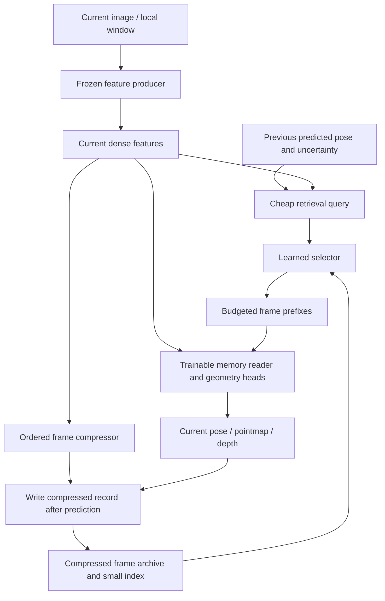

# Compressed feature memory and learned retrieval for streaming SLAM

**Status:** Research proposal, not an implemented SLAM system. Mechanisms explicitly marked as proposals or hypotheses have not been evaluated. Two Sol research slices investigated streaming reconstruction systems and selector credit assignment; primary sources and limitations are recorded below.

**Companion:** [Ordered latent compression for reusable model features](general-latent-compression.md). That document defines the parallel codec, prefix losses, all-prefix decoding, and direct-consumer interface. This document adds persistent memory, spatial association, sparse retrieval, and causal online prediction.

## 1. Core idea

A streaming geometry model produces a feature map for each frame or bounded frame window. Storing and attending to every historical dense feature map is expensive. Compress each frame record into a short ordered code sequence, retain cheap searchable metadata, and train a reader to use a small selected set of historical codes when predicting current geometry and pose.

The selector receives a pose proposal available before current geometry decoding—initially the previous predicted camera—and optionally a cheap current-image descriptor. During training, explore a wider candidate set containing predicted choices, geometric proposals, globally distributed/retrieved examples, and random records. Use the reader's task loss, attention diagnostics, and attention-logit gradients to improve the selector, with occasional removal experiments checking whether those proxy scores track actual utility.

**D1 — Shared codec, separate system.** Autoencoder-like prefix training can initialize the same codec as the general framework. Retrieval and geometric usefulness need additional SLAM-specific training.

**D2 — Spatial association, not mandatory hard anchors.** Camera poses, frame pointmap bounds, submap identity, and learned descriptors may guide retrieval. A globally summarizing code does not necessarily occupy one compact 3D location. Explicit local anchors are an optional variant, not a prerequisite.

**D3 — Active memory is not total memory.** Sparse retrieval bounds the reader's working set. Fixed per-frame compression alone still creates an archive that grows with time. Eviction, fusion, consolidation, and offloading are separate policies.

**D4 — Train a real consumer.** A pretrained backbone does not automatically understand new compressed codes. Initially retain a frozen feature producer and train an external memory reader and geometry heads. Replacing its internal recurrent state or layerwise KV cache is a different, more invasive experiment.

## 2. Proposed architecture and memory contract

C1

The current-feature path into the query is optional and must use only information available before memory decoding. Keep current features dense initially; the experiment concerns historical memory, not simultaneous compression of every subsystem.

For historical frame or keyframe j, store

$$
m_j=(Z_j,r_j,\hat T_j,\kappa_j,b_j,c_j,t_j,s_j),
\qquad Z_j=(z_{j,1},\ldots,z_{j,K_j}).
$$

Here r_j is a compact retrieval descriptor, T_j a predicted pose in an identified coordinate frame, kappa_j calibration, b_j optional observed-geometry bounds, c_j confidence, t_j time, and s_j submap/provenance. This is a candidate schema, not a demand that every field be transmitted or retained. Count every retained field in memory measurements. The symbol b_j here denotes geometric bounds; later attention gates use beta_j to avoid ambiguity.

If source features were contextualized within a window, record that provenance. They are not equivalent to independent image embeddings or to every layer's historical KV cache.

### 2.1 Preserve the prefix contract

The straightforward retrieval unit is a **frame plus a prefix length**, not an arbitrary code:

$$
\mathcal S_t=\{(j,k_j)\},\qquad \sum_{j\in\mathcal S_t}k_j\leq B.
$$

B is the historical code-token budget. Keep current tokens, special tokens, and any mandatory global state separately accounted for.

A code z_{j,7} may refine information in z_{j,1:6}; selecting only z_{j,7} violates the training distribution of a prefix decoder. Start with a fixed prefix length per frame and learn frame selection. Later allow budgeted prefix extensions, charging for required predecessors. A token's marginal utility must then be measured conditional on its earlier prefix being present.

Alternatives are independently decodable local blocks, or a decoder explicitly trained with arbitrary subsets. Both change the original codec objective and should be named as distinct variants.

### 2.2 What can be spatially indexed?

- **M1 — Frame records:** Camera frustum, predicted visible point bounds, appearance descriptor, and submap identity provide coarse support. This is the simplest starting point.
- **M2 — Local code blocks:** Compress patch/region groups and attach local coordinates or learned support distributions. This improves spatial access but may sacrifice cross-region compression efficiency.
- **M3 — Explicit map anchors:** Fuse observations into region/voxel/pointer codes, potentially with a small global scene code. This changes a per-frame archive into a scene map and requires update training.

Do not assign each globally mixed latent the bounding box of a particular patch without establishing its support. Encoder attention can suggest support, but is not proof of exclusive geometric locality. Frame-level bounds can overlap despite occlusion or useless viewing geometry.

## 3. Querying before the current pose is decoded

A feasible query is

$$
q_t=Q_\eta(\hat T_{t-1},u_{t-1},a_t),
$$

where u_{t-1} summarizes uncertainty/motion and a_t is an optional cheap current-image descriptor. Relative pose, orientation, intrinsics/field of view, time gap, appearance similarity, and confidence can enter the score against m_j. A small indexed descriptor search should precede an expensive pairwise scorer if the archive is large; scanning every record still has a cost even when the reader is sparse.

The previous camera is a useful **proposal**, not an always-correct query. Slow translation does not imply slow rotation, and a narrow field of view can change quickly. Motion jumps, dropped frames, drift, occlusion, dynamic scenes, and lost tracking break a purely local assumption. A constant-velocity or inertial proposal is an optional improvement if available, not an assumed input.

Use previous predicted poses in training, including realistic prediction error. Do not train selection with current ground-truth pose and then deploy it with a delayed predicted pose. The current decoder's outputs or attention-derived teacher scores cannot be selector inputs if they only exist after selection.

A global appearance/coverage path should remain available during early experiments. The system can learn how strongly to trust geometric metadata, and later test learned-only retrieval, but removing every fallback is an empirical result to establish—not an automatic consequence of sufficient flexibility.

## 4. Candidate selection: local detail and global alignment

For a training step, form a bounded candidate union

$$
\mathcal C_t=
\mathcal C_{\mathrm{predicted}}
\cup\mathcal C_{\mathrm{geometry}}
\cup\mathcal C_{\mathrm{global}}
\cup\mathcal C_{\mathrm{random}}.
$$

- **S1 — Predicted:** The learned selector's current best choices under the deployment budget.
- **S2 — Geometric:** Nearby cameras, uncertain-frustum overlap, pointmap-bounds overlap, and recent frames. These are proposals, not ground-truth relevance labels.
- **S3 — Global:** Appearance-based revisit candidates, reference/older keyframes, and spatially diverse coverage. Geographically distant records can be essential for alignment or loop closure.
- **S4 — Exploration:** Random records, preferably with age/region coverage so a long archive does not starve older areas. Log the sampling policy for reproducibility and coverage analysis.

Deduplicate the union and bound its token cost. Decode the candidates jointly rather than enumerating all combinations. Unexamined records are **unlabeled**, not negative examples. Random exploration improves coverage but does not establish that the best memories were included; measuring a full-archive miss rate requires a defined evaluation protocol, not merely knowledge of random-sampling probabilities.

Local and global utility can conflict. Initially keep separate diagnostics or quotas for local reconstruction and global alignment. Later test a learned joint allocation. Pure attention mass or average pixel loss may favor nearby duplicate views while missing a rare frame that prevents drift.

## 5. Can attention or gradients identify useful memories?

Yes as training signals, with an important distinction: **local attention sensitivity is not the causal value of removing a memory**.

### 5.1 Attention mass is a proxy

High attention can indicate use, but contribution also depends on values, value magnitudes, residual paths, heads, later layers, and redundancy. Multiple attention patterns can yield similar outputs. Two near-duplicate memories can each look dispensable while removing both is damaging.

Reader-to-retriever attention distillation has direct published precedent in question answering (R9). Atlas compares attention, likelihood, and leave-one-out teachers rather than assuming attention is the unique correct signal (R10). Transferring these methods to continuous geometry losses remains a hypothesis.

### 5.2 The gradient proposed in the discussion has a precise meaning

For one attention output, add a scalar gate beta_j to memory j's logit:

$$
\alpha_j=\operatorname{softmax}(\ell+\beta)_j,
\qquad o=\sum_j\alpha_jv_j.
$$

Then

$$
\frac{\partial\mathcal L}{\partial\beta_j}
=\alpha_j\left\langle\frac{\partial\mathcal L}{\partial o},v_j-o\right\rangle.
$$

- **G1 — Positive derivative:** Locally, increasing this memory's relative attention worsens the loss; gradient descent lowers its logit.
- **G2 — Negative derivative:** Locally, increasing its relative attention improves the loss.
- **G3 — Near-zero derivative:** May mean irrelevance, redundancy, low current attention, saturation, or an already well-fit prediction. It is not a deletion certificate.

For a gate shared across all tokens in a frame block and multiple queries/heads/layers, backpropagation automatically sums the corresponding contributions. The signed quantity -dL/d(beta_j) is a candidate per-example ranking target. Absolute gradient magnitude answers a different question—sensitivity—not whether attention should increase or decrease.

If every key is a retrieved memory, these logit gradients sum to zero for each softmax: they describe relative reallocation. Allowing current-frame evidence or a null-memory option lets the reader decline historical information, but still does not yield calibrated absolute removal utility.

### 5.3 Why deletion is different

Removing one token and renormalizing changes the single attention output by

$$
o_{-j}-o=\frac{\alpha_j}{1-\alpha_j}(o-v_j).
$$

A local derivative does not capture this finite change, later nonlinearities, or interactions with other removed memories. The task-level removal utility is instead

$$
U_j(\mathcal C)=
\mathcal L(\operatorname{Reader}(\mathcal C\setminus\{j\}))
-\mathcal L(\operatorname{Reader}(\mathcal C)).
$$

Positive U_j means removal hurts on that example and coalition. Even exact single-removal utility is not a complete ranking for selecting a much smaller set when memories complement or substitute for one another.

A finite-difference check during document preparation verified the single-output gate derivative. No selector, attention-utility correlation, or SLAM performance has been tested.

## 6. A practical training algorithm without exhaustive subsets

The following is a proposed recipe assembled from retrieval-training precedents, not an existing validated SLAM method.

### T1 — Pretrain the codec

Freeze the chosen feature producer. Train per-frame or per-window code prefixes to reconstruct stored features, optionally also matching frozen geometry outputs. Use the companion document's sampled-prefix decoder baseline before optimizing all-prefix computation.

Feature reconstruction is a useful initialization, not sufficient evidence that the codes preserve cross-view correspondences or global pose. Retain special camera/register information explicitly or account for it through the trained interface.

### T2 — Adapt the pretrained memory interface

Start from the released Spann3R checkpoint, a fixed number of codes per historical frame, and the real deployment budget B. Keep the current feature/query grid dense. Train the compressor and K/V projections together with a deliberately limited memory/head adapter; freeze the image feature producer initially. Adapting only the final pointmap head may be insufficient if the memory read has already discarded useful information.

The lower-risk control reconstructs original K/V before the frozen reader. The direct compact-memory experiment instead emits fewer compatible K/V slots and adapts the interface through geometry/readout losses. Compare these explicitly: dense expansion tests archive compression, while direct compact reads can also reduce active attention cost.

Spann3R has public checkpoints and training code, but the checked-in default training recipe is not established as the exact recipe for the v1.01 checkpoint. Reuse the existing feedforwardfoam assets if verified, without modifying its environments or running experiments. HorizonStream remains a later alternative: archiving compressed snapshots of its per-frame/recurrent state is conceivable, but attending to those snapshots requires a separately trained read interface and is not an existing drop-in capability.

### T3 — Compare several sets on the same target

The preferred initial scorer supervision is **detached, within-target loss comparison**, not low absolute reconstruction loss across unrelated samples. An easy target can have low loss regardless of memory; a difficult target can benefit greatly from a good set and still have high loss.

For target t and a fixed causal memory snapshot, construct a few sets S_(t,1), ..., S_(t,M), each with the same frame/code budget. Include the selector's choice, geometric/global alternatives, and random or sampled-swap choices. Cache the source image features and codes, evaluate each set with the same geometry reader, and record its loss L_(t,m). Use eval-mode/dropout-controlled inference without gradients for these label-producing passes.

These are alternatives within one prediction problem, not a rollout in which the first candidate changes memory for the second. Restore memory tensors, attention counters, confidence bookkeeping, and recurrent state between candidates. Use identical targets, validity masks, coordinate/gauge conventions, and loss normalization. The current query must not have been computed using information available to only one candidate.

For an equal-budget replacement of selected frame i by alternative j, define

$$
\Delta_{j\leftarrow i}
=L_t(S)-L_t((S\setminus\{i\})\cup\{j\}).
$$

Positive delta supports preferring j over i conditional on the unchanged companion frames. Train the scorer on detached pairwise loss differences or a listwise ordering of the evaluated sets. No backward pass through the geometry model is needed for those ranking labels; the scorer itself is trained normally with gradients.

Two scorer parameterizations should be distinguished:

- **T3a — Frame scores:** Cheap independent scores, supervised by matched swaps. Selection is easy, but independent scores cannot fully represent redundancy or complementary frame combinations.
- **T3b — Set-aware scores:** Condition a candidate on already selected frames, or score a small collection of candidate sets using pooled descriptors. This better matches set utility but requires a corresponding bounded inference search/greedy selection policy.

Use ranks or pairwise comparisons within a target to avoid treating absolute sample difficulty as relevance. If loss magnitudes are used as confidence weights, normalize within the target with a robust spread or a fixed reference loss and a denominator floor; do not divide blindly by a near-zero minimum loss. Ignore or downweight nearly tied comparisons. A frozen full-memory or fixed-policy reference can help report improvement, but a globally standardized loss across unrelated targets is not the main supervision signal.

### T4 — Keep attention-gradient supervision as a measured alternative

For a cheaper differentiable alternative, add a **bounded** selector-dependent bias to selected blocks' attention logits, for example beta_j = c*tanh(s_j), with fixed c. Train through the final geometry loss and test against the detached-ranking approach. A controlled temperature/norm and regularization prevent score magnitude from becoming the only way to influence the reader.

This does not reward indefinite bias growth: softmax is invariant to a common logit shift, relative logits can saturate, and score magnitude is not calibrated usefulness. Hard selection membership remains nondifferentiable; unread records get no gradient. Keep candidate exploration and allow the reader to ignore historical memory.

Wider candidate unions can still supply attention- or gate-gradient-based distillation targets. Treat them as local, coalition-dependent proxies, stop gradients through the targets, and compare them against the measured same-target rankings rather than declaring them correct. Geometry-detail and alignment contributions should be monitored separately.

### T5 — Benchmark the supervision variants before committing

Compare the following on the same real sequences, code length, and selected-frame budget:

| Code | Variant | Geometry-model work | Main question |
|---|---|---|---|
| B4 | One selected set, task-gradient attention bias | One differentiable reader evaluation | Is the cheap local signal useful and stable? |
| B5 | Several same-target sets, detached rankings | Multiple no-grad reader evaluations plus scorer backward | Are more faithful ranking labels worth their cost? |
| B6 | Wider-union gradient teacher plus narrow student | Teacher forward/backward and deployment-budget student update | Does gradient distillation beat simpler comparisons? |
| B7 | Sparse swaps/group removals | A few additional controlled inference evaluations | Do proxy rankings agree with actual task effects? |

Feature extraction can often be cached, but memory read plus the paired geometry decoder/heads still runs for each candidate. Batch candidate sets when memory permits; measure peak memory, forward/backward time, data transfer, candidate-label throughput, and downstream quality per unit of training time. Do not assume all variants cost only a tiny final head.

Train reader/head adaptation on the actual B-budget input distribution. Label generation can use a frozen or periodically refreshed reader; avoid allowing the reader to manipulate its own detached labels within an update. Once codec/reader parameters change, cached codes and loss labels may become stale and need refreshing.

Several candidate sets are not exhaustive search. They give stronger comparisons among the evaluated alternatives but no labels for excluded records. Preserve exploration, audit redundancy with occasional group perturbations, and evaluate long-term alignment rather than only immediate reconstruction.

### T6 — Train the online distribution

Use memories and pose proposals generated by the model's own causal rollouts. Include revisits, pose uncertainty, fast rotations, frame gaps, dynamic distractors, and tracking failures. Keep exploration during training after heuristic quotas are reduced. Refresh cached retrieval keys when their encoder changes; otherwise labels and index scores become stale.

After basic frame selection works, allow adaptive prefix lengths and optional learned-only spatial retrieval. Online recompression or fusion is a separate subsequent change requiring its own long-horizon training.

## 7. What should the task loss critique?

The codec's reconstruction loss and the selector's task loss serve different purposes.

- **L1 — Archived-feature fidelity:** Decode historical features from their stored prefixes during codec training. This is the reusable autoencoder objective.
- **L2 — Geometry:** Predict current depth/pointmaps and cross-view-consistent quantities using current features plus selected memory. Use valid/occlusion-aware losses and appropriate scale/gauge conventions.
- **L3 — Alignment:** Supervise relative/global pose, cross-submap consistency, revisits, and long-horizon drift where labels or reliable teacher outputs exist.
- **L4 — Functional distillation:** Match a richer-memory or offline teacher, while keeping teacher outputs out of the selector's inference inputs. Fidelity to the teacher is not identical to physical accuracy against ground truth.

Do not make the reader reconstruct a current feature tensor that is already available unchanged in its dense input: it can copy that input and ignore memory. Similarly, exclude the current frame's own just-created archive record from retrieval. Recent overlapping historical frames are legitimate evidence and should not be universally removed, but use revisit/long-range evaluations to detect a selector that learns only recency or trivial copying.

An average reconstruction loss alone can underweight a small but decisive correspondence. Track task-specific failure modes and alignment separately from mean pixel/feature error.

## 8. Spatial anchors versus learned-only selection

The design can test increasing levels of structure without committing to a hard geometric index forever:

| Variant | Retrieval information | Expected tradeoff to test |
|---|---|---|
| A1 — Heuristic | Previous pose, frustum/pointmap overlap, recency, global coverage | Cheap and interpretable; brittle to uncertainty and missing geometric cues |
| A2 — Learned with metadata | Learned query/key plus relative pose, confidence, and coarse support | Can exploit geometry while correcting heuristic mistakes |
| A3 — Learned without explicit spatial metadata | Pose-free appearance/content query and learned memory descriptors, or a separately tested pose-query-only variant | More flexible, but must discover geometry from task supervision and may generalize poorly |
| A4 — Explicit local pointers | Codes attached to local 3D anchors/submaps | Efficient spatial lookup and fusion; vulnerable to coordinate error and may constrain globally useful codes |

There are two distinct meanings of “anchor-free”: no per-code XYZ coordinates, and no spatial metadata anywhere. A selector can be anchor-free in the first sense while still using camera poses and frame bounds. Keep those ablations separate.

For explicit anchors, prefer local submap coordinates plus adjustable submap transforms when pose corrections are expected. A globally corrected map may require refreshed metadata and index entries; an immutable feature code need not be rewritten merely because an external transform changes. If coordinates are embedded inseparably into the codes, that separation no longer holds.

A fixed finite state cannot preserve unlimited novel scene detail at fixed fidelity. Repeated views may consolidate cheaply, but exploration of new regions must consume capacity or cause controlled forgetting.

## 9. Related streaming systems and choice of experimental base

“HorizonSLAM” could not be verified under exact-name and variant searches. **HorizonStream may be the intended reference**, but that is not an assertion about the user's intended name. It combines local attention with long-term recurrent state rather than merely retaining a moving window.

Dates below identify the initial preprint. The table compares architecture and interface fit, not a universal state-of-the-art ranking.

| Ref | Primary source | Memory and retrieval mechanism | Relevance / limitation |
|---|---|---|---|
| R1 | [Spann3R](https://arxiv.org/html/2408.16061v1), Aug. 2024 | External geometric key/value memory, dense recent working memory, sparse long-term retention using accumulated attention | Closest interpretable external-memory baseline; reading retained memory is not cheap preselection of a tiny frame subset |
| R2 | [CUT3R](https://arxiv.org/abs/2501.12387), Jan. 2025 | Recurrent learned state, current-view geometry and virtual-view readout | Compact implicit-memory comparator; not a spatially indexed frame archive or complete loop-closing backend |
| R3 | [Point3R](https://arxiv.org/html/2507.02863v1), July 2025 | Explicit pointers with 3D positions and features; nearby pointers fuse/update | Closest explicit-anchor precedent; nearest-neighbor insertion/fusion is not proof of pose-conditioned sparse retrieval |
| R4 | [StreamVGGT](https://arxiv.org/html/2507.11539v1), July 2025 | Causal global attention with historical layerwise KV caches; distillation from VGGT | Useful cache baseline; original all-history cache grows, and a frame code is not a drop-in replacement for every cached layer |
| R5 | [TTT3R](https://arxiv.org/html/2509.26645v1), Sept. 2025 | Training-free, attention-derived confidence gate for CUT3R state updates | Tests update/retention rather than archive selection; reported very-long-sequence protocol includes resets |
| R6 | [VGGT-SLAM 2.0](https://arxiv.org/html/2601.19887v1), Jan. 2026 | Local submaps, globally retrieved keyframes, attention-based overlap verification, graph corrections | Complete hybrid SLAM reference with a frozen frontend; attention verification occurs after candidate processing, not as a cheap pre-selector |
| R7 | [HorizonStream](https://arxiv.org/html/2605.23889v1), May 2026 | Local causal attention plus bounded recurrent geometric state, learned retention and metric readout; optional loop backend | Relevant local/global-state comparator, not independently retrievable per-frame prefixes; training/integration changes are substantial |
| R8 | [LONG3R](https://openaccess.thecvf.com/content/ICCV2025/papers/Chen_LONG3R_Long_Sequence_Streaming_3D_Reconstruction_ICCV_2025_paper.pdf), ICCV 2025 | Attention-based memory gating and spatial pruning | Direct selection precedent; it computes current-query attention over memory before gating, so it does not establish cheap pose-based preselection |

The [original VGGT-SLAM](https://arxiv.org/html/2505.12549v1) already combines local keyframes with global historical retrieval. “Feed-forward SLAM” often means a feed-forward neural frontend inside a system that still performs geometric verification and graph optimization. Do not silently drop those capabilities when comparing systems.

### 9.1 Retrieval and attribution precedents

| Ref | Primary source | What it establishes | What it does not establish |
|---|---|---|---|
| R9 | [Distilling Knowledge from Reader to Retriever](https://arxiv.org/abs/2012.04584), ICLR 2021 | Train a retriever from reader attention using synthetic relevance targets | Attention as exact removal utility, or transfer to SLAM |
| R10 | [Atlas](https://arxiv.org/html/2208.03299v3), JMLR 2023 | Compares attention, likelihood, and leave-one-out retriever teachers; discusses index staleness | A universally best credit target; all objectives are evaluated in a different domain |
| R11 | [REALM](https://arxiv.org/abs/2002.08909), ICML 2020 | Task-driven retrieval-score learning over truncated candidate support, index refreshing, and a null retrieval option | Differentiability through all excluded candidates or arbitrary hard top-k membership |
| R12 | [Is Attention Interpretable?](https://arxiv.org/abs/1906.03731), ACL 2019 | Gradient-based rankings and actual erasure can disagree with attention magnitude | Gradients as a universal gold-standard explanation |
| R13 | [Are Sixteen Heads Really Better than One?](https://arxiv.org/abs/1905.10650), NeurIPS 2019 | First-order mask-gradient importance and the difference between individual and joint removal | Direct evidence for selecting compressed frame codes |

### 9.2 Conservative starting point

- **B1 — Scientific frontend experiment:** Use an external-memory pattern like [released Spann3R](https://github.com/HengyiWang/spann3r), or a fixed released geometry feature producer with a new external reader. Keep current features dense, archive frame prefixes, and initially use fixed per-frame budgets. This isolates compression and selection rather than redesigning the full backbone.
- **B2 — Complete SLAM evaluation:** Use [VGGT-SLAM 2.0](https://github.com/MIT-SPARK/VGGT-SLAM) as a local-window/global-loop system reference or backend context. Keep the backend and version fixed when comparing frontend memory policies. Its original reader still cannot consume unfamiliar compressed codes without a trained interface.
- **B3 — Follow-on comparisons:** Point3R for hard spatial association, CUT3R/TTT3R for compact implicit state and retention, StreamVGGT for layerwise caches, and HorizonStream for long-horizon local/recurrent attention. Match reset, loop, calibration, and alignment protocols.

At inspection, HorizonStream's official repository exposed inference/checkpoints/evaluation and optional loop code but did not mark training-code release complete. StreamVGGT exposes a training/distillation path, but its paper fine-tunes the geometric stack while freezing only the image backbone. Availability can change; pin exact source/checkpoint versions before experiments.

## 10. Novelty assessment

**N1 — Established ingredients:** Compressed latent bottlenecks; learned recurrent or external spatial memory; explicit 3D pointers; recent-plus-global frame retrieval; attention-based retention; reader-to-retriever distillation; gradient-based saliency.

**N2 — Candidate differentiated combination:** A cheap causal selector, proposed from previous-pose/appearance information, over ordered compressed frame-prefix records; trained from bounded expanded-candidate reader evaluations with task-gradient credit and sampled counterfactual audits; serving a direct geometry reader under an explicit token/byte budget.

**N3 — What could make it a real contribution:** Demonstrate that this combination improves total memory/latency at matched geometry and tracking quality, preserves useful old evidence, and learns beyond geometric heuristics. Separately show whether explicit anchors help or are unnecessary. No inspected source establishes the complete combination, but this focused search is not a novelty proof.

## 11. Experiments and failure criteria

The runnable Spann3R implementation, audited datasets, checkpoint/optimizer
smokes and initial same-target cost measurements are documented in
[experiments/spann3r/README.md](experiments/spann3r/README.md).
Those checks establish implementation feasibility, not the quality claims below.

- **E1 — Codec viability:** Compare raw/quantized features, similarity pruning/merging, fixed learned bottlenecks, and ordered prefixes. Measure geometry preservation as well as feature error at matched bytes.
- **E2 — Selector value:** Hold codec and reader fixed where possible. Compare recency, geometry, appearance retrieval, random/diverse selection, bounded task-gradient gating, detached same-target set rankings, and gradient distillation at the same active budget.
- **E3 — Credit quality and cost:** Compare proxy rankings with fixed-budget swaps and sampled group-removal losses. Benchmark multiple no-grad candidate reads against gradient-based variants, measure missed useful candidates and local versus global utility, and treat excluded candidates as unknown.
- **E4 — Spatial dependence:** Compare metadata-rich retrieval, learned-only retrieval, and explicit pointers. Test pose noise, rapid turns, occlusion, relocalization, low-overlap views, repeated textures, and dynamic objects.
- **E5 — Long-horizon behavior:** Run online rollouts with revisits and genuinely new regions. Measure drift, tracking failures, historical forgetting, map consistency, and retrieval latency as archive size grows. Compare retention/fusion policies separately from active selection.

Report trajectory error with explicit alignment/gauge conventions, relative pose error, depth/pointmap quality, revisit success, and tracking failure rate. Report both ground-truth accuracy and any teacher fidelity distinctly.

Account separately for archive bytes, active GPU codes/KV, current-window features, recurrent state, index/metadata, decoded map outputs, loop archives, transfer, compression, search, readout, and backend optimization. Include p50/p95 latency and growth with explored scene size; a smaller code bank alone is not proof of faster SLAM.

Reject or revise the approach if feature reconstruction is good but correspondence/pose fails; if selection gains disappear at the real B budget; if compression/indexing costs erase readout savings; if the learned selector only follows recency; or if long-term state silently loses information needed at revisits.

## 12. Relationship to the general framework

The general framework learns a reusable rate/quality representation. This system additionally decides **which historical observations to read now**, **how much of each to read**, and **what to preserve for future revisits**. These are separate decisions.

Start with immutable compressed frame records and frame-level metadata so the codec can be shared. Only introduce learned fusion into spatial codes after the retrieval experiment establishes value; fusion changes the reconstruction target and requires repeated-update supervision. Spatially selective decoding is then a potential capability, not something automatically inherited from a globally mixed latent sequence.

## TL;DR

Compress historical frames, retrieve valid prefixes with a cheap pose/appearance-conditioned selector, and adapt a pretrained geometry reader at the real deployment budget. Prefer comparing several equal-budget sets on the same target to using absolute loss or attention as relevance labels; benchmark detached loss rankings against bounded attention-gradient training. The most promising novelty is the measured integration of progressive compression and causal learned memory selection—not spatial memory or attention supervision by itself.
